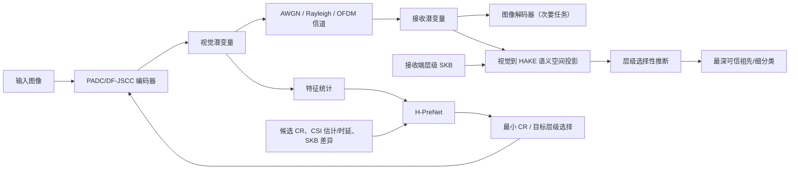

# 基于 HAKE 与可复现图像语义通信代码的研究转向与实验计划

## Material Passport

- Origin Skill: `academic-research-suite / experiment-agent`
- Origin Mode: `plan`
- Origin Date: `2026-07-23`
- Verification Status: `LITERATURE-CHECKED; EXPERIMENTS UNVERIFIED`
- Version Label: `code_plan_v1`
- 本地材料范围：
  - `C:/Users/xinyuxie/Desktop/博士参考文献表.html`
  - `D:/Paper/语义入门资料/code+paper（写代码重点看）`
  - `C:/Users/xinyuxie/Desktop/Multi-modal-Semantic-Hierarchy-aware-Semantic-Communciation-main/reproduction/FULL_REPRODUCTION_AUDIT.md`
  - 当前 `D:/PyChram_project/CognitiveSemCom`
- 文献检索截止日期：`2026-07-23`
- 重要说明：本文是研究与实验规划，不包含尚未执行的实验结果；“可能创新”均为本轮检索边界内的判断，不是绝对的新颖性保证。

## 1. 结论先行

研究方向应当转向，但不应继续把 iSAC、iRML 或 GAIL 作为新工作的依赖前提。

推荐采用“两篇论文阶梯”，而不是把 HAKE、PPO、OOD、SKB、OFDM、多用户和大模型一次性拼在同一篇论文中：

1. **第一篇（主线、风险最低）**  
   **HAKE-HSC-PreNet：面向 OOD 与知识失配的风险校准层级语义图像传输。**
   - 从已有可运行的 PADC/DeepJSCC-V/DF-JSCC 类图像链路出发。
   - 把博士工作中的“预测重建 PSNR 后选压缩率”改为“预测在给定压缩率和信道下能够可靠达到的语义层级”。
   - 接收端不确定时不强行输出错误细分类，而是退回到正确祖先类。
   - HAKE 用于表示类别/属性的层级知识，但必须与显式树、TransE 和无 KGE 方案公平消融。
   - 主要评价任务语义风险、预测具体度和通信开销，PSNR 只作为次要指标。

2. **第二篇（第一篇验证后再做）**  
   **VoSS-SKB：基于“语义具体度价值”的事件触发式增量知识库对齐与多用户资源分配。**
   - 只有当缺失知识会阻止接收端从祖先类提升到更具体且可靠的类别时，才同步对应的 HAKE 子图或实体增量。
   - 联合选择图像压缩率、知识增量和无线资源。
   - 复用当前项目的本地 cloud-edge SKB 模拟与增量对齐实现，并复用 SFOM-PPO/WBGM-IC 的资源分配问题形式作为基线或后续扩展。

第一篇的核心不是“再做一个 JSCC 网络”，而是把组内工作从 **PSNR 驱动的语义通信** 推进为 **可控风险、可退化、可解释的层级任务语义通信**。

## 2. 为什么需要这样转向

### 2.1 当前可确认的资产

| 资产 | 可复用内容 | 在新方向中的角色 | 风险 |
|---|---|---|---|
| 已复现 HAKE | 层级知识嵌入、WN18RR 训练与评估经验 | 类别/属性 KG 表示、层级消融 | 图像标签与 WN18RR 实体映射覆盖率尚未核验 |
| PADC/OraNet 本地代码 | 性能预测、压缩率选择、DeepJSCC-V | 第一篇的物理链路和点预测基线 | 需先在当前环境重新审计 |
| Dynamic-JSCC | 自适应码率、软/硬选择 | 自适应传输基线 | 年份较早，但仍是机制基线 |
| OFDM-JSCC | 导频、多径、信道估计、OFDM | 不完美 CSI 与多径压力测试 | 不应一开始就并入主模型 |
| WITT | Transformer 图像 JSCC、CSI 调制 | 强编码器基线 | 训练成本较高 |
| Deep image semantic communication for AIoT | 分割/任务语义链路 | 第二任务或分割扩展 | 与第一篇分类主线同时做会扩大范围 |
| 当前 CognitiveSemCom | OOD 注入、本地 SKB server、增量对齐、语义一致性实验框架 | 第二篇的本地可复现同步模拟 | 当前 KG 推理链路与图像链路不宜硬耦合 |
| 博士近两年论文 | DF-JSCC、PreNet、ISSE-PPO、SFOM-PPO、WBGM-IC | 问题定义、基线与待改进假设 | 未发现可直接依赖的公开完整代码 |

博士参考文献表中的近两年研究链条可以概括为：

| 论文 | 核心内容 | 本计划中的处理 |
|---|---|---|
| [PreNet Aided DF-JSCC](https://doi.org/10.1109/TVT.2025.3608154) | DF-JSCC、特征增强、依据特征统计/SNR/CR 预测重建 PSNR | 第一篇最直接的问题起点；把点 PSNR 预测改为层级任务风险预测 |
| [基于深度灵活编码策略与性能预测的无线语义图像传输系统](https://doi.org/10.11959/j.issn.1000-436x.2025094) | DF-JSCC 与 PreNet 的中文完整系统描述 | 用于论文忠实重实现与参数核对，不假设存在公开代码 |
| [PPO-driven semantic spectral efficiency](https://doi.org/10.1109/LCOMM.2025.3566081) | 联合选择 CR、信道与功率，优化 PSNR/CR 派生目标 | 第二篇多用户基线；不把 PPO 本身作为第一篇贡献 |
| [SFOM-PPO](https://doi.org/10.1109/TCOMM.2025.3649655) | 多 BS/SINR、特征重要性排序和 PPO 资源分配 | 作为“重建重要性 + 资源分配”强邻近工作，改进点应转向任务层级风险 |
| [WBGM-IC](https://doi.org/10.1016/j.phycom.2025.102873) | 多对多 D2D 的二部图匹配、干扰聚类与功率约束 | 第二篇的确定性可行性层或多用户对照，不进入第一篇 |

### 2.2 博士近两年工作的主要可改进假设

1. **“语义”仍主要由 PSNR 表示。**  
   ISSE/SFOM 中的语义效率主要来自 PSNR 与压缩率的组合，无法区分“把狗错成猫”和“把拉布拉多错成金毛”这两类不同的语义损失。

2. **PreNet 是点预测，且目标是重建质量。**  
   点预测不能告诉控制器其失败风险，也不能说明当前条件下究竟能可靠恢复到“动物”“狗”还是“拉布拉多”。

3. **多任务仍接近数据集/分辨率切换。**  
   CIFAR100 与 Kodak 的区分不能完全代表下游任务、意图和层级语义需求。

4. **通常假设 CSI 当前且准确、收发知识一致。**  
   实际上 CSI 估计误差、反馈时延、接收端知识缺失都会产生语义层面的失配。

5. **PPO 是求解器，不是足够强的创新点。**  
   离散动作 PPO、连续/混合动作扩展和特征重要性资源分配均已有大量相邻工作。新论文应先证明新的语义目标和机制，再决定是否需要 RL。

## 3. 近期文献碰撞：哪些不能再作为单独创新

| 候选想法 | 已有直接或高度相关工作 | 判断 |
|---|---|---|
| 共享知识库后只传类别/索引 | [Shared-SKB generative SemCom](https://arxiv.org/abs/2405.05738)、[CLIP-KB image transmission](https://arxiv.org/abs/2504.01053) | 不能单独作为创新 |
| 显式语义基、残差图像和细粒度重传 | [Explicit semantic base](https://arxiv.org/abs/2308.06599)、[Semantic Base Enabled Fine-Grained HARQ](https://doi.org/10.1109/TWC.2025.3532501) | 已明显拥挤 |
| 多层特征 + SKB + 动态信道 + DRL | [Zero-shot multi-level feature transmission](https://arxiv.org/abs/2305.12619)、[IEEE IoT-J 2025 工作](https://ieeexplore.ieee.org/document/10778255) | 不能只做“多层特征选择” |
| OOD 图像语义通信 | [MLLM-based OOD image SemCom](https://arxiv.org/abs/2407.15335) | OOD 必须是压力测试或与非 LLM 层级退化结合 |
| 层级粗到细图像编码 | [Coarse-to-Fine hierarchical image compression](https://arxiv.org/abs/2605.08266) | 不能把“粗到细码流”作为唯一贡献 |
| 层级特征 + 信道自适应 | [Hierarchy-aware channel-adaptive data fusion](https://arxiv.org/abs/2503.17777) | 需明确区别任务语义与视觉多尺度特征 |
| 收发端知识失配 | [TCL-SC against mismatched KBs](https://arxiv.org/abs/2301.03133) | “考虑失配”本身不新 |
| SKB 协同更新 | [Cooperative SKB update](https://arxiv.org/abs/2410.02405)、[TCOM DOI](https://doi.org/10.1109/TCOMM.2025.3636085) | 第二篇必须以层级任务风险驱动选择更新内容 |
| Conformal/不确定性用于语义通信 | [Semantic Meta-Split Learning](https://arxiv.org/abs/2409.12978)；2026 年已有 channel-shift conformal 预印本 | 不能只把 conformal 套到系统上 |
| 层级不确定时退回祖先类 | [Hierarchical Selective Classification, NeurIPS 2024](https://papers.neurips.cc/paper_files/paper/2024/hash/c8b100b376a7b338c84801b699935098-Abstract-Conference.html) | 该机制本身不新，但尚可研究其与无线传输、码率预测和 KB 失配的联合问题 |
| HAKE 层级 KGE | [HAKE, AAAI 2020](https://arxiv.org/abs/1911.09419) | HAKE 是已知组件，创新必须来自新的通信问题与验证 |

因此，建议的精确新颖性主张是：

> 在有噪无线传输、压缩率选择和收发知识失配共同存在时，联合预测“可可靠达到的语义具体度”，并让接收端按风险退回到最深的可信祖先概念；进一步研究 HAKE 表示是否能比显式树或普通 KGE 更好地支持这一通信决策。

本轮检索未发现把以下四项直接联合起来的论文：

1. 图像 JSCC 的发送前性能预测；
2. 层级选择性预测的祖先退化；
3. HAKE/层级 KG 表示；
4. 信道与 SKB 失配下的最小码率选择。

这是“检索范围内可能创新”，投稿前仍需做一次标题、摘要、引用链和专利的最终查新。

## 4. 第一篇论文：HAKE-HSC-PreNet

### 4.1 暂定题目

**Risk-Calibrated Hierarchical Semantic Image Transmission under Channel and Knowledge Mismatch**

中文可表述为：

**面向信道与知识失配的风险校准层级语义图像传输**

### 4.2 研究问题

- RQ1：在相同信道使用次数下，层级选择性接收能否比平面分类或纯 PSNR 优化保留更多正确且有用的语义？
- RQ2：发送端能否根据图像特征、候选压缩率、CSI 及知识失配程度，预测接收端能可靠达到的最深语义层级？
- RQ3：HAKE 是否比显式树、TransE 或无知识嵌入更有助于 OOD/失配条件下的祖先恢复？
- RQ4：能否选择满足目标层级风险的最小压缩率，而不是最大化未经校准的 PSNR/ISSE？

### 4.3 可证伪假设

- H1：在低 SNR、语义 OOD 或接收端缺失细粒度知识时，HAKE-HSC 的层级风险—覆盖曲线优于平面分类和 PSNR 驱动方案。
- H2：H-PreNet 在给定目标风险 `alpha` 下选择的最小压缩率，比 PADC/OraNet 或 PSNR-PreNet 使用更少的 channel uses，同时不显著降低规定层级上的任务成功率。
- H3：HAKE 对深层 WordNet/iNaturalist 层级的收益显著大于对两层 CIFAR100 层级的收益。
- H4：如果显式树 HSC 与 HAKE-HSC 无显著差异，则 HAKE 不是必要贡献，应从论文标题和主张中移除。

### 4.4 系统结构



### 4.5 HAKE 必须承担的实际功能

HAKE 不能只用来画嵌入图。建议至少实现下列两项：

1. **语义分类头**  
   把接收视觉潜变量投影到 HAKE 实体空间，以 HAKE 分数或距离形成叶节点/内部节点概率。

2. **知识失配描述**  
   用缺失实体、关系或子图在 HAKE 空间中的覆盖和距离描述收发 SKB 差异，并作为 H-PreNet 的输入。

可选的第三项是用 HAKE 子图定义第二篇的知识增量包。

### 4.6 不使用 LLM

本计划不需要 LLM/LAM API。类别层级来自 CIFAR100 taxonomy、WordNet 或 iNaturalist taxonomy；视觉分类器、HAKE 和 JSCC 均在本地运行。这与当前项目的可复现、本地模拟约束一致。

## 5. 实验计划

### 5.1 阶段 0：基线可复现性闸门

先只复现，不加入 HAKE。

优先顺序：

1. PADC/OraNet 或其 DeepJSCC-V 子项目；
2. Dynamic-JSCC；
3. WITT 的预训练测试或小规模训练；
4. OFDM-JSCC 的导频、多径和信道估计；
5. NeurIPS 2024 HSC 的官方代码。

官方可用代码：

- [HAKE 官方代码](https://github.com/MIRALab-USTC/KGE-HAKE)
- [Hierarchical Selective Classification 官方代码](https://github.com/shanigoren/Hierarchical-Selective-Classification)

通过条件：

- 能在固定环境与固定种子下完成训练/测试；
- 至少复现论文曲线的相对趋势；
- 若使用公开 checkpoint，记录文件哈希；
- 统一导出逐样本结果，而不只保存平均 PSNR；
- 任一关键基线失败时，不以论文中的数字代替本地实测数字。

### 5.2 阶段 1：无信道的层级语义最小闭环

目的：先证明层级问题成立，不让无线链路掩盖模型缺陷。

数据：

- Smoke test：CIFAR100，20 个 coarse 类、100 个 fine 类；
- Formal test：ImageNet-100 + WordNet 深层 taxonomy；
- 可选外部验证：iNaturalist 子集。

任务：

- 闭集细粒度分类；
- 层级选择性分类；
- 每个 coarse 类留出一个 fine 类作为语义 OOD；
- 报告 flat top-1、coarse accuracy、hierarchical coverage、hierarchical risk 和 hAURC。

模型对比：

- Flat softmax；
- 显式树 HSC；
- TransE + HSC；
- HAKE + HSC；
- 可选 Poincaré/hyperbolic embedding + HSC。

闸门：

- 如果 HAKE 不能在深层 taxonomy 上稳定优于显式树或 TransE，则停止把 HAKE 作为核心方法；
- CIFAR100 只用于调试，不能单独支撑“层级表示优势”结论。

### 5.3 阶段 2：加入单用户 JSCC

固定图像语义头，依次接入：

1. AWGN；
2. Rayleigh；
3. OFDM multipath。

初始因素：

- `SNR ∈ {-5, 0, 5, 10, 15, 20} dB`
- `CR ∈ {0.05, 0.10, 0.20, 0.30, 0.50}`，若基线只支持其他离散值，则使用其原生配置；
- 信道随机种子对所有方法配对复用。

对每个样本和 operating point 保存：

- ground-truth fine/coarse label；
- 接收预测节点及其深度；
- 是否为正确祖先；
- 预测置信度；
- channel uses、CR、SNR；
- PSNR、MS-SSIM、LPIPS；
- 推理时延。

### 5.4 阶段 3：H-PreNet 与最小码率选择

H-PreNet 输入：

- 编码器特征的逐通道均值与标准差；
- 候选 CR；
- CSI 估计值；
- CSI 误差或反馈 age；
- HAKE/SKB 覆盖特征；
- 可选 OOD score。

输出不得只是一项 PSNR。至少比较：

1. 点预测：期望层级效用；
2. 多任务概率：各层级正确概率；
3. 分位数或预测区间：层级风险上界；
4. 校准后的“最深可信层级”。

控制问题：

```text
minimize     channel_uses(CR)
subject to   estimated hierarchical risk(level, CR, CSI, KB) <= alpha
```

首版使用枚举全部候选 CR，获得可审计的最优解。只有当动作空间扩展到多用户、功率、RB 和知识更新后，才引入 PPO/SAC 或混合动作 RL。

### 5.5 阶段 4：OOD、CSI 和知识失配压力测试

OOD 分开报告，不能混成一个指标：

1. **Covariate shift**：噪声、模糊、压缩、亮度等图像扰动；
2. **Semantic shift**：训练未见的 fine 类，但其祖先在 taxonomy 中存在；
3. **Knowledge shift**：接收端缺失叶节点、属性或关系；
4. **Channel shift**：训练与测试 SNR/多径分布不同。

CSI 条件：

- perfect CSI；
- additive estimation error；
- delayed CSI / Doppler；
- 信道模型错配。

知识失配：

- 随机缺失与重要节点定向缺失必须分开；
- missing ratio 可取 `{0%, 10%, 30%, 50%}`；
- 发端完整/收端陈旧，以及两端分别演化的情况分开报告。

注意：Conformal 或 HSC 的有限样本保证通常需要交换性。跨信道分布偏移时不得宣称无条件覆盖保证；应报告实测 violation rate，并把在线/加权校准作为扩展而非先验结论。

## 6. 基线与消融矩阵

### 6.1 第一篇必须实测的基线

| ID | 方法 | 作用 |
|---|---|---|
| B0 | 固定 CR DeepJSCC/DeepJSCC-V | 基础 JSCC |
| B1 | Dynamic-JSCC | 传统自适应率 |
| B2 | PADC/OraNet | 性能预测驱动自适应率 |
| B3 | WITT | Transformer/CSI-aware 强基线；算力不足时至少做公开 checkpoint 测试 |
| B4 | Flat task head | 无层级任务基线 |
| B5 | Explicit-tree HSC | 检验“只用树就够不够” |
| B6 | TransE-HSC | 检验 HAKE 的层级建模价值 |
| B7 | Oracle CR selector | 给定真实接收结果时的上界 |

SFOM-PPO 应放在多用户扩展中，不应硬塞进第一篇单链路主实验。

### 6.2 关键消融

- 去掉 HAKE，仅用显式树；
- HAKE 换成 TransE；
- 去掉 HSC，强制输出 leaf；
- 去掉 H-PreNet，固定 CR；
- H-PreNet 只预测 PSNR；
- H-PreNet 不输入 SKB 差异；
- perfect CSI vs imperfect/delayed CSI；
- matched SKB vs stale/missing SKB；
- ID vs covariate OOD vs semantic OOD；
- 不同 taxonomy 深度；
- 冻结 HAKE vs 联合微调；
- oracle knowledge / oracle CSI / oracle CR。

## 7. 指标与统计设计

### 7.1 主指标

不要用单个自定义“语义效率”比值代替原始结果。主文至少同时报告：

- fine-class accuracy；
- ancestor/coarse accuracy；
- hierarchical coverage（预测具体度）；
- hierarchical selective risk；
- hAURC；
- target-risk violation rate；
- channel uses 或实际 payload。

主结果建议用“风险—具体度—开销”三维关系的两个二维切片：

1. 同开销下的层级风险—覆盖曲线；
2. 同目标风险下的 channel uses—具体度曲线。

### 7.2 次指标

- PSNR、MS-SSIM、LPIPS；
- ECE、Brier score、NLL；
- 预测区间覆盖率和宽度；
- 推理时延、FLOPs、参数量；
- OOD 检测 AUROC（若使用 OOD score）。

### 7.3 统计

- 端到端训练至少 5 个独立种子；
- 每个 checkpoint 使用相同的成对信道样本；
- 报告均值、标准差和 95% bootstrap CI；
- 主要成对比较使用 permutation test 或 Wilcoxon signed-rank；
- 多个主要比较使用 Holm 校正；
- 同时报告效应量，不以 `p < 0.05` 代替实际增益；
- 在实验前固定主指标、主要 operating points 和排除规则。

## 8. 预注册式成功与停止门槛

以下是工程目标，不是预先宣称的结果：

### Gate A：图像标签—HAKE 映射

- 选定正式数据集后，核验标签到已复现 WN18RR 实体的覆盖率；
- 覆盖率 `>= 90%` 才直接复用已有 embedding；
- 否则在对应 WordNet 子图上重新训练 HAKE，并把原 WN18RR 结果作为代码正确性证据而非直接模型资产。

### Gate B：层级语义有效性

- HAKE-HSC 必须在至少一个深层 taxonomy 上优于 flat 和 TransE；
- 若只在两层 CIFAR100 上有效，不形成 HAKE 核心论文。

### Gate C：自适应传输价值

- 在相同目标层级风险下，相对 PADC/PSNR-PreNet 减少至少 10% channel uses，或在相同开销下将 ancestor accuracy 提高至少 5 个百分点；
- 两者均不满足时，停止扩展多用户/RL。

### Gate D：风险校准

- ID 条件下目标覆盖率偏差控制在约 `±3` 个百分点；
- shift 条件下完整报告退化，不通过后验选择样本制造“覆盖保证”。

### Gate E：知识失配

- matched SKB 下不能明显牺牲闭集精度；
- stale/OOD 条件下错误 leaf 应更多转化为正确 ancestor，而不是仅增加 root/拒识比例。

## 9. 第二篇：VoSS 驱动的增量 SKB 对齐

只有第一篇 Gate B–E 通过后开展。

### 9.1 与已有 SKB update 工作的区别

已有 cooperative SKB update 已研究多通信对之间选择“掌握较好”的知识上传并形成全局 SKB。因此第二篇不能只做 partial update。

建议定义 **Value of Semantic Specificity（VoSS）**：

```text
VoSS(delta_K) =
expected reduction in hierarchical task risk
or expected increase in reliable prediction depth
per synchronization bit and latency
```

系统只同步使 VoSS 为正且超过阈值的实体、关系或子图。更新目标由当前任务、信道和接收端预测风险共同决定，而不是仅由全局知识完整度决定。

### 9.2 动作与基线

动作：

- `no_sync`
- `incremental_entity/relation_sync`
- `full_sync`
- 图像 CR
- 可选 RB、功率和 MCS

基线：

- no alignment；
- periodic full alignment；
- periodic incremental alignment；
- score-based cooperative SKB update；
- task-agnostic delta selection；
- oracle delta selection。

成功目标：

- 达到 full-sync 至少 95% 的层级任务效用；
- 同时降低至少 40% 的同步 payload；
- 不能只报告“知识一致性”，必须报告接收任务风险和可靠预测深度。

## 10. 不建议作为当前主线的方案

1. **继续修 iSAC/iRML/GAIL**  
   当前不可复现，不应成为新论文实验地基。

2. **只把 HAKE 换进当前 452 维状态并继续 GAIL**  
   这会形成“替换 embedding”的弱增量，而且无法利用图像语义通信的组内代码优势。

3. **只做 continuous/hybrid PPO**  
   属于求解器扩展，博士论文也已明确将其作为未来工作，单独新颖性不足。

4. **只做 HAKE 特征重要性 + UEP**  
   与显式 semantic base、fine-grained HARQ、importance ordering 和 2026 层级编码高度相邻。

5. **只做 OOD 检测或只加 conformal prediction**  
   相邻工作已存在；应作为“可靠祖先退化和码率控制”的组成部分。

6. **一开始就做多用户 OFDM + SKB + OOD + PPO**  
   变量过多，任何结果都难以归因，且会重新陷入不可复现问题。

## 11. 建议实施顺序与预期产物

### 第 1–2 周：审计与冻结基线

- 形成每个本地项目的环境、数据、checkpoint、训练和测试清单；
- 选择一个主 backbone：优先 PADC/DeepJSCC-V；
- 输出 `baseline_reproduction_manifest.json`；
- 不改当前 `STATE_DIM=452` 主线，在独立的 image-SemCom 实验目录中实施。

### 第 3–4 周：层级数据与 HSC

- 完成 CIFAR100 taxonomy；
- 核验 ImageNet/WordNet 与 WN18RR 实体交集；
- 复现 HSC 官方代码的核心曲线；
- 形成 flat/tree/TransE/HAKE 四组结果。

### 第 5–8 周：JSCC + HAKE-HSC

- 接入 AWGN/Rayleigh；
- 保存逐样本中间结果；
- 完成第一轮主消融；
- Gate B 失败则及时收缩方向。

### 第 9–11 周：H-PreNet 与码率控制

- 先用有限候选 CR 穷举；
- 比较点预测、分位数和校准层级预测；
- 完成同风险下的带宽比较。

### 第 12–14 周：OOD、CSI 与 KB mismatch

- 执行预定义 shift；
- OFDM 作为最后的物理层增强；
- 不在看过结果后改变 OOD 划分。

### 第 15–16 周：正式统计与论文骨架

- 5 seeds；
- paired channel evaluation；
- 置信区间、效应量、失败案例；
- 输出可复现命令、配置与 manifest。

## 12. 计划中的仓库结构

以下只是一份实施建议，尚未创建：

```text
reproduction/
  image_semcom/
    baselines/
      padc/
      dynamic_jscc/
      witt/
      hsc/
    configs/
    manifests/
research/
  hierarchical_semcom/
    data/
    hake_bridge/
    semantic_head/
    hprenet/
    channels/
    evaluation/
experiments/
  eval_hierarchy_no_channel.py
  eval_hierarchy_jscc.py
  eval_hprenet_rate_control.py
  eval_shift_robustness.py
```

计划阶段不虚构入口命令。完成阶段 0 的代码审计后，每个正式实验必须有：

```text
python <entrypoint> --config <frozen_yaml> --seed <seed>
```

并写出：

- 完整配置；
- git commit 或源码快照哈希；
- 数据划分哈希；
- checkpoint 哈希；
- 逐样本 CSV/Parquet；
- 汇总表与绘图脚本。

## 13. 最终研究定位

最稳妥的定位不是“我们提出了一个更强的图像重建网络”，而是：

> 现有自适应语义图像传输主要预测重建质量并优化平均性能，但在信道恶化、OOD 与知识失配时仍可能给出高置信度的错误细粒度语义。我们研究一种通信条件下的层级保守决策机制：发送端预测达到目标语义具体度所需的最小传输资源，接收端在证据不足时返回最深可信祖先，并系统检验 HAKE 层级知识表示是否能改善这一风险—具体度—开销权衡。

该定位与博士现有的 DF-JSCC、PreNet、ISSE/SFOM 研究连续，也能真实利用已经复现的 HAKE，同时不依赖不可复现的 iSAC/iRML。
