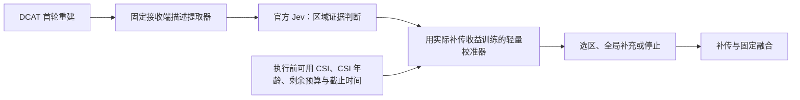

# Jev 用于图像补传：可用性结论与准确率验证协议

> 历史记录（2026-09-26）。本文下方“尚未实现/下一步”等执行状态保留为当时记录。当前已完成实际组件小试和完整流水线开发，原始方法未显示优势；请以 [预实验结果](PILOT_RESULTS.md)、[完整协议](FULL_EXPERIMENT_PROTOCOL.md) 和 [就绪报告](READINESS.md) 为准。

## Material Passport

- 技能：academic-research-suite；deep-research + experiment-agent / plan。
- 日期：2026-09-26；版本：candidate_v1。
- 文献/接口状态：已核查所列一手来源；官方 API 已完成真实接口小试。
- 科学验证状态：**图像补传方法未实现，任务准确率未测，创新性未完成全文排重，未证明超过 SOTA**。
- 本目录服务于独立的图像传输研究；DCAT 是明确记录的外部基线，未修改旧 KG 项目、STATE_DIM 或 DCAT 源码。
- 用户已选定 TypeSafe 直连并提供本机环境变量；运行只发送本文件所述人工构造文本，不发送本地研究文档或图像。

## 1. 当前可以确认什么

**官方 Jev 可以作为候选决策模块使用，已经实际调用成功；值得进入小规模任务验证。**

| 判断 | 证据/状态 |
|---|---|
| 官方账号与接口可用 | 8 次真实请求全部 HTTP 200，返回 `jev-1.13.0` |
| 三种决策类型可用 | Choice、Score、Noul 返回通过格式及值域检查 |
| 简单文本条件可以映射到有限动作 | 8 个请求符合预先写好的人工样例预期，包含一次选项倒序和一次重复 |
| 图像补传选区准确 | **尚未测量**；这些人工样例不需要视觉理解或预测补传收益 |
| Visual Jev 有可复现入口 | 作者代码、推理示例、4B LoRA 适配器公开；本机尚未下载或运行 |
| 新方法有独立收益/达到 SOTA | **尚未证明**，必须完成下文的反事实动作评测与消融 |

本次接口小试：8 次请求，共 4,780 输入 token、814 输出 token；客户端总耗时中位数 **1,428.94 ms**，范围 **1,312.96–1,704.93 ms**。单客户端顺序调用、未重试，包含网络连接与服务等待，未分解模型推理时间；样本过小，不能据此估计 p95 或服务 SLA。

结果：

- [summary.json](results/interface_probe_20260926T110610172815Z/summary.json)
- [逐请求记录](results/interface_probe_20260926T110610172815Z/records.jsonl)
- [接口探针源码](probe_typesafe.py)

探针源码运行时 SHA256：`e693ada6aa28fd44c7362ed4539d96a922a7bc962647d6e3c3e8108bc45838ea`。密钥只从环境变量读取，不写入这些文件。

## 2. 官方 Jev 与 Visual Jev 的关系

TypeSafe 当前版本 `jev-1.13.0` **只接收文本/JSON，不接受图像**，且不支持客户自行微调。必须先从接收端已有图像/特征产生描述，再交给官方 Jev。固定版本 ID，保存完整输入、概率和返回版本；不用会漂移的 `jev-latest`。[官方模型说明](https://docs.typesafe.ai/models)

数值预算、时间比较、成本和收益计算由代码完成。官方文档也明确其精确数值能力有限，Score 的等级期望不能当作真实 PSNR 增益。[能力边界](https://docs.typesafe.ai/model-jaggedness/jev-1.13)

Visual Jev 是第三方论文的视觉实现，基于 Qwen3-VL-4B，并非 TypeSafe 官方视觉权重。采用作者的 LM-head 候选读出和已发布的 answer-SFT LoRA；不要把自行生成回答当作复现其候选读出。[作者代码](https://github.com/guanxuyu-sv/Visual-Jev)、[权重与加载说明](https://huggingface.co/guanxuyu/visual-jev-4b-answer-sft)

作者报告的原始 4B → answer-SFT 准确率：GQA 87.9%→91.6%，SNLI-VE 62.9%→80.8%，TextVQA 97.4%→97.5%，TallyQA 34.0%→34.5%。这些是其构造的选择题任务，改善主要集中在训练任务族；不是图像補传准确率。其附录的证据充分性扩展未改善决策，宏平均反而下降 1.3 个百分点。32 问题下的 5.7 ms/问是摊销数，整个批次约 182 ms，不能当作单次控制延迟。[论文表 2–4、附录 A](https://arxiv.org/html/2609.25845v1)

实现边界：当前 quickstart 支持 Choice，候选数 2–16；本研究 6 个候选动作在接口范围内，但该动作语义不在其已验证任务里。模型卡说明发布适配器的训练候选数为 2/4，应记录与论文训练构造的差异。运行前固定代码 commit、底座 revision 和适配器 revision；本轮公开 API 元数据链接抓取失败，尚未取得这些不可变 revision，不填写虚构 SHA。

## 3. 收敛的候选论文问题

建议工作题目：**基于 Jev 决策收益校准的接收端图像补传：考虑 CSI 老化与决策等待的可靠性评估**。

研究问题：

> 将 Jev 对接收端可观察信息的判断，校准为各补传动作的实际收益，并在动作执行前纳入最新可用 CSI、等待时间和剩余资源，能否在同通信/能量上限与截止时间下，降低严重重建失败？

这是一个范围可控的应用方法研究，不要求重训基础模型。拟验证的贡献有三项，均为假设：

1. **校准目标是补传收益**：区别于“这块看起来模糊”或“模型对自己的选择很确定”。
2. **判断返回时重新评估动作价值**：描述采集时刻、Jev 返回时刻、真正发送时刻分开记录，使用执行前最新可用信息，处理动作过时。
3. **以错误代价检验模型**：同时报告选区准确率、错误选择损失了多少质量、最终严重失真比例，以及完整时延和通信代价。

不能写成已证实的贡献，也不能仅以换用 Jev 宣称创新。

### 与直接前作的界限

| 前作 | 已覆盖内容 | 本研究需要证明的差异 |
|---|---|---|
| [Jev for 6G Edge Networks，9 月 19 日预印本](https://arxiv.org/html/2609.23136v1) | Jev 解释服务合同、缓存解释、数值调度，并计入控制等待 | 本文控制图像内容补传，标签是重建质量反事实；缓存和数值调度本身不是新贡献 |
| [JEV-as-a-Judge，9 月 22 日预印本](https://arxiv.org/abs/2609.26550) | 置信度接受/升级机制 | 仅增加置信度阈值不能作为独立新意 |
| [ROI + 多轮反馈，IEEE WCL 2026](https://ieeexplore.ieee.org/document/11352529/) | ROI 与前向/反馈符号分配 | 需阅读全文确认与接收端收益预测、时间变化的差别；目前仅核对摘要 |
| [JSCCformer-f](https://arxiv.org/html/2306.09101v3) | 根据反馈改善接收端重建，包含可变长度机制 | 接收端发起的有限动作选择、因果 CSI 与等待成本不能只停留在概念描述 |
| [不确定性引导的多模态补特征](https://arxiv.org/abs/2601.14942) | 为不确定样本请求额外特征 | “按不确定性补传”已有先例；此处仅核对摘要 |
| [DCAT](https://arxiv.org/abs/2509.11243) / [FAST](https://arxiv.org/abs/2401.14614) | 动态信道/老化适配；重要性及信道预测分配 | 保持底层能力一致，隔离新增接收端决策的增益 |

本轮针对 Jev + image transmission / semantic communication / retransmission / JSCC 的检索未核实到完全相同的机制；**检索未命中不等于已证明首创**。ROI 反馈全文仍是排重缺口。Jev 近期论文均按预印本记录，不推断录用或研究质量。

## 4. 具体如何接入

固定候选：四个象限、补充全局、停止。第一版固定两轮，不引入视频帧间差分。

### 接收端输入来源

| 字段 | 允许的来源 | 限制 |
|---|---|---|
| 区域内容/可见损伤描述 | 首轮重建图上的固定本地视觉前端 | 前端需先实现和独立检查；不能人工看原图替模型描述 |
| 区域质量或可靠性特征 | 接收端图像/解码特征，训练期可用原图监督 | 测试时不得计算参考图像误差后当作输入 |
| CSI 与时间 | 当前已到达的估计、导频时间戳、历史值 | 不得输入未来真实 CSI 或实际第二轮结果 |
| 历史动作与预算 | 本地协议账本 | 包含控制和反馈，统一资源单位 |

官方 Jev 的原子问题可分别询问局部证据是否不足、哪些损伤关系支持增强、已有增强是否可能冗余；输出概率作为特征。全部精确运算由代码完成，模型不读真值、不执行预算算术。

**重要成本与必要性检查**：文本 Jev 没有视觉能力，描述前端是实质组件。若只能提供简单的模糊分数和数值排序，规则或 MLP 很可能已足够；若必须先调用大型视觉模型，必须计入其耗时，并与该视觉模型直接决策比较。不能把前端完成的工作归给 Jev。

Visual Jev 比较臂直接接收首轮重建图和同一协议状态。其完整概率与 TypeSafe 的 `confidence` 都不能直接解释为“补传后成功率”。[官方 confidence 定义](https://docs.typesafe.ai/confidence)

### 最小方法形式

令 `p_a` 为 Jev 的候选判断特征，`z_rx` 为可部署接收端特征，`c_exec` 为执行前可获得的信道信息。轻量函数预测：

`g_hat(a) = f_theta(p_a, z_rx, c_exec, CSI_age, elapsed_time, remaining_budget)`。

训练标签是同一首轮状态下实际尝试动作后的 `MSE_before - MSE_after`，而非模型自评。先做收益回归/排序；严重失真风险预测作为后续独立目标，不能把平均 MSE 优化直接说成尾部风险优化。停止动作收益基准为 0，开销为实际已发生的成本。

若年龄只作为所有区域的共同正乘数，区域排序不会改变；这种设计只能影响停止/增强量，不能宣称实现了老化感知选区。应检验区域与信道的交互是否确有证据，避免强行增加交互项后默认有效。

### 官方 API 等待如何处理

- 本次 1.43 秒客户端中位数说明：当前接入不适合直接假设毫秒级在线请求。允许截止时间较宽的静态图像场景，完整计入 API 等待。
- 对严格短截止时间，官方 Jev 可用于离线提供训练信号，部署本地选择器，但应另称“Jev 辅助训练”，不能写成在线 Jev 结果。
- 预测补传信道时使用执行前已知估计。等待中若有新导频，CSI 年龄会重置；不能简单把等待时间全部累加到旧年龄，也不能免费给新导频。
- 官方 API 的请求/返回另经服务网络，统计服务网络流量、时延、可用性；说明其是否与实验无线链路共享资源。不可把外部服务网络当作无代价捷径。
- Visual Jev 的本地用时也实测完整调用，包括描述/预处理、传输到 GPU、模型与决策返回；不采用论文的摊销时间代替。

## 5. 如何测“决策准确率”

### 先生成独立于任何选择器的动作结果表

每个接收端状态保存全部候选动作的实际重建结果和成本，再比较策略。`receiver_state` 与含真值的 `action_outcomes` 分文件；请求构造只接受前者的白名单字段。

保持编解码、融合、首轮结果与动作集合一致。对未来随机信道进行多次条件采样；用于标签估计的未来轨迹与最终评估轨迹分开。看到某一次未来噪声后选动作的 hindsight oracle 只提供诊断上界。

| 指标 | 定义/用途 |
|---|---|
| 近优动作命中率 | 选中动作的期望 MSE 收益在最优动作的预先固定容差内；容差来自开发集噪声与实际意义 |
| 选择损失（regret） | 最优可行动作的收益减去实际选中动作的收益；均值、分位数均报告 |
| 风险与校准 | 若输出被校准为成功概率，则按对应真实事件计算 Brier/ECE、风险-覆盖率；不把原始 Choice 概率自动当成功率 |
| 重建质量 | PSNR、统一定义 LPIPS、PSNR 第 5 百分位、预先固定严重失真阈值下的失败率 |
| 成本 | 信道使用量、反馈量、导频、能量、API/视觉前端/决策总耗时、完整截止时间违约率 |
| 稳定性 | 选项次序、描述轻微改写、重复请求、未见 SNR/速度/CSI 年龄、图像信息受损 |

不可只用 top-1 准确率：两个近乎等价区域选错并不严重，而错误停止可能损失很大。超时、非法响应和失败请求都保留，按预先定义的本地回退策略计入质量与成本，不能从准确率分母静默删除。

### 两层公平比较

1. **选择器准确率诊断**：统一执行时刻和动作结果表，分析判断质量；明确排除了各模型运行等待，不能据此声称端到端优势。
2. **真实时序闭环**：同一图像与绝对信道时间轴，各方法按自身真实耗时推进；在其返回后重新计算可行动作及协议状态，评价全流程。不能让慢方法继续使用为快方法生成的未来动作结果。

| 组别 | 必须比较的模型/策略 |
|---|---|
| 同文本描述 | 官方 Jev；规则；同输入的轻量文本/特征选择器；必要时 Laya 文本对照 |
| 同图像与状态 | Visual Jev 4B；同底座 Qwen3-VL-4B 的原始候选读出；视觉轻量选择器 |
| 通信协议 | 同总预算单轮 DCAT；两轮全局；随机区域；固定重要性；仅不确定性；oracle |
| 机制消融 | 原始 Jev；Jev + 收益校准；再加入执行时 CSI/等待修正；完整停止策略 |
| Jev 独立价值 | 同样校准器与特征预算，移除/替换 Jev 特征；描述前端直接决策 |

文本组与图像组的跨组差异只能称为完整系统差异；模型能力结论应来自同输入组内。所有可训练对照有相同数据划分和调参机会。CSI 年龄消融仅改变选择器输入，DCAT 编解码自身的老化能力保持一致。

## 6. DCAT 的低成本可行性路径

基线根目录：`D:/PyChram_project/DCAT-SoM/SoM-DCAT-main`。历史评估：`D:/PyChram_project/DCAT-SoM/results/20260920_232752_published_inference_suite/REPORT.md`。

既有模型是单轮 encoder → channel → decoder，并非原生两轮渐进编解码。第一诊断可用冻结的 C64 全图，再将某个 64×64 区域放大到 128×128，使用第二个 C64 独立编码，解码后缩小并按固定规则融合；全局补充对照走相同第二轮预算。**该流程尚未实现，只是明确的最小验证方案**，不称为复现原生 ROI 算法。

C64 含 2,048 个复信道载荷符号，C128 含 4,096 个。C64+C64 只在载荷上等于 C128；区域控制、反馈和新导频使总成本更高。预实验可以隔离选区价值，但正式结论必须统一完整预算或比较质量-总成本曲线。

先逐区域做反事实测试，比较实际可达 oracle 与全局/随机增强。理想无噪声原图替换仅做几何上界，不能代替实际编码补传。若这个简单 codec 的 oracle 无明显空间，只说明此实现不值得训练复杂选择器，不否定所有 ROI 编解码方法。

## 7. 有界验证顺序与继续投入判据

### P0：接口检查——已完成

8 次人工样例请求；只支持“账号/端点/类型可调用”的结论。未进行模型下载、图像训练或正式准确率实验。

### P1：oracle 空间——下一步最先实施

从未用于挑选策略的开发图像中固定 16 张，2 个 SNR、2 个 CSI 年龄档、3 条独立轨迹，共 192 个首轮状态；每个状态最多 5 个非停止增强动作，共 960 次增强推理。该规模是工程小试，不能证明尾部失真率改善。

先比较实际 oracle 与最强简单增强对照，并报告配对分布。预先以原始 MSE 定义最小有意义收益，再看数据；若没有稳定空间，调整 codec/动作集，而不训练 Jev 校准器。

### P2：模型决策小试——P1 有空间后

预先划定独立图像的训练/校准/盲测集合；小试可先用 160 张新图，64/32/64 划分，每图沿用 12 个状态，共 1,920 个状态。这是预算建议，不是功效保证。冻结描述前端、英文问题模板、候选动作、校准方式和容差后才打开盲测结果。

官方 Jev 每状态一次请求并行多个原子问题；Visual Jev 用同一图像批量问题。分别保存原始概率、前端成本、调用时间、错误、回退、决策及真值索引。不得根据已看过的 DCAT 最终测试结果持续调整 prompt。

### P3：能否支持论文——基于结果判断

进入完整实验至少需要：

1. oracle 对实际简单策略有可复现空间；
2. Jev 特征在同输入的强对照之上减少选择损失；
3. 等待与全部资源计入后，优势仍存在于明确的截止时间范围；
4. CSI/等待修正、校准或停止至少一项有独立消融贡献；
5. 补齐 ROI 反馈全文比较及代码/模型不可变版本记录。

正式训练至少 3 个独立种子；同图多条信道轨迹，按图像聚类计算配对区间，另报告训练种子变异。稀有失败事件所需图像数/轨迹数由小试的方差和目标效应确定，不能把 1,920 个相关状态视为 1,920 张独立图。

若官方 Jev 被简单规则替代后没有损失，论文不能宣称 Jev 的必要性；可如实转为决策模型的通信场景评测。若只在宽松截止时间下有效，应限定应用场景。当前明确建议是 **继续 P1/P2 小试，保留官方 Jev 主候选；不启动大规模新模型训练**。
